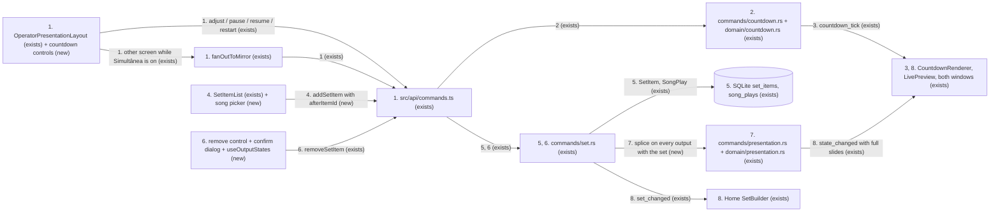
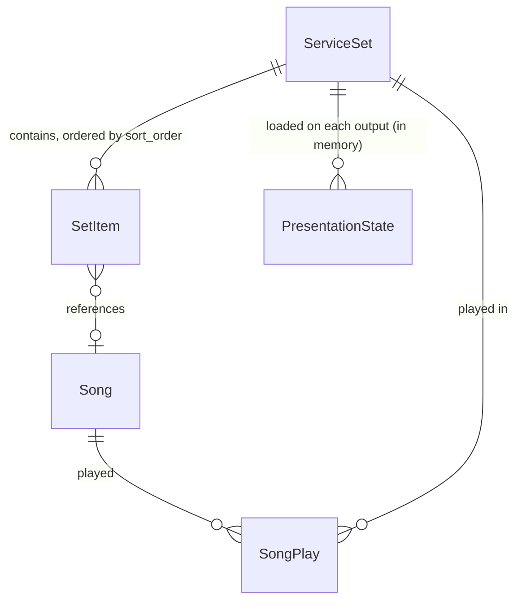
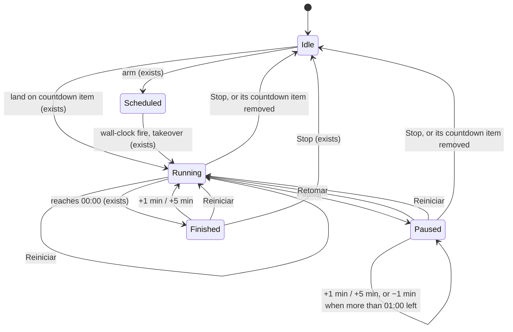

# Live countdown controls and live set list

**Approved**: 2026-10-26 - user: "approved"

## Problem

During a service the operator cannot change a countdown that is on the wall. When the start slips
by five minutes, the countdown reaches 00:00 in front of the congregation. The backend has
`pause_countdown` and `reset_countdown` but nothing that adds time or resumes, and the presentation
layout puts no countdown control in front of the operator. The scheduled widget's `Cancelar` is the
only one, and it resets. Stop does not help either: it resets the countdown (P20-01), and Apresentar
starts it again at its full configured duration.

The set list is frozen while presenting. Every nav tab is disabled (`OperatorApp.tsx:503-552`), and
the presentation layout has no way to add or remove a song. When the pastor calls for a song that is
not in the set, the operator has to stop, which blacks the wall, edit on Home, and present again,
which restarts at item 0, slide 0 (`load_set_for_presentation`, `presentation.rs:590-594`). The code
paths that exist half-work. `add_set_item` splices into the live snapshot for Tela 1 only
(`append_item_to_live_presentation`, `presentation.rs:408`). `remove_set_item` deletes the row and
never touches a live snapshot. The request itself gives no field evidence; what this section states
about the current behaviour comes from the code.

When this ships, the operator can give the countdown more or less time, pause it, resume it and
restart it from the presentation screen. They can also add a song right after the one playing, or
remove an item that is not on screen. The wall never blanks, and every screen showing the set keeps
its place.

## Shape

This reuses the countdown ticker and its drift-free wall-clock target (D-7),
`compute_item_slides` for the new song's slides, `with_full_slides` for the emit, the
`sort_order` shift `duplicate_set_item` already does, and the `INSERT OR IGNORE` of
`record_set_start` for the play row. No second slide or countdown pipeline is added. The rules that
change an outcome run in pure Rust helpers that `cargo test` reaches (TESTING.md: `domain/*.rs`
unit), with the commands as lock-and-emit shells. Those rules are: the countdown's next state after
each control, the −1 min floor, which item counts as on screen, and how each stored index shifts
after an insert or a remove. The enabled and disabled state of each control is a pure frontend
helper that `vitest` reaches.

1. operator uses a countdown control -> `OperatorPresentationLayout` (exists) with the countdown controls (new) -> `src/api/commands.ts` (exists) for the focused output, and `fanOutToMirror` (exists) for the other one while Simultânea is on
2. `commands/countdown.rs` (exists) - new `adjust_countdown`, `resume_countdown`, `restart_countdown`; the next `CountdownState` comes from a pure rule in `domain/countdown.rs` (exists); the ticker is aborted or spawned under the task lock, as `start_countdown` does
3. out: `countdown_tick` (exists) to both windows; `CountdownRenderer` (exists) on the wall and `LivePreview` (exists) redraw
4. operator uses `Adicionar música` -> `SetItemList` (exists) with the song picker (new) -> `addSetItem({ setId, itemType: "song", songId, afterItemId })`
5. `commands/set.rs::add_set_item` (exists) - shifts `sort_order` after the anchor, inserts and persists `SetItem`; while the set is presenting, persists today's `SongPlay`
6. operator uses remove -> confirm dialog (new); the control is disabled for an item on screen on any output, read through `useOutputStates` (new) -> `removeSetItem(itemId)` -> `commands/set.rs::remove_set_item` (exists) - refuses with `set.item_on_screen` when the item is on screen on any presenting output, otherwise deletes the `SetItem` row
7. `commands/presentation.rs` (exists) - splices the item into or out of every output whose loaded set is this set: `set.items`, `presentation_slides`, `item_slide_counts`, `current_item_index`, `frozen_at`, `next_slide`; the index arithmetic is a pure helper in `domain/presentation.rs` (exists)
8. out: `state_changed` carrying the full slides (`with_full_slides`) to both windows, and `set_changed` (exists) so Home's `SetBuilder` reloads

**Changes underneath**

| Front | What changes |
| --- | --- |
| domain | `PresentationState.set.items` meant "fixed for the life of a load, except an append on Tela 1"; now it changes length at any position mid-presentation, on every output with that set. Readers that index by position today: `SetItemList`, `StrophesGrid` (`allSlidesPerItem[i]`), `LivePreview`, `PresentationApp` (`currentItem` drives the countdown landing effect by id), `reconcileSlides` in `stores/presentation.ts` (keeps the previous slides when an emit carries none, which is why the splice must emit full slides) |
| domain | `remove_set_item` meant "always delete"; it now refuses an item on screen on a presenting output. Its only other caller, Home's `SetBuilder`, cannot run while presenting (the nav is locked), so Home never sees the refusal |
| domain | `CountdownState.duration_ms` keeps meaning "the configured duration". A live adjustment moves only `target_epoch_ms` and `remaining_ms`, so `Reiniciar` and Stop's reset still return to the configured time |
| stored data | `set_items.sort_order` is rewritten for the items after the insertion point, as `duplicate_set_item` does today. `song_plays` gains a row for a song added while presenting. Nothing to migrate or backfill |
| readers | Home `SetBuilder` (reloads on `set_changed`); the Reports screen (the CCLI count includes the added song); Tela 2 presenting the same set (now receives adds and removes; today only Tela 1 gets an append); the slideshow import (`Apresentação` button), which appends through the same splice and so reaches Tela 2 too |

New: nothing - new rows in existing tables only. One-way constraints: none (`song_plays` already
dedups on `(song_id, set_id, played_on)`).

## Surface

None - nothing consumed outside. These Tauri commands are consumed only by `src/api/commands.ts`
in the same build, and only the operator window calls them; the presentation window calls none of
them (CLAUDE.md read-only invariant). Each failure is an `ErrorPayload { code, params }`, and each
code below becomes a Coverage set in checks.md.

- `adjust_countdown(deltaMs: i64, output?)` (new) → `CountdownState`. The operator sends `60000`, `300000` or `-60000`. Fails with `countdown.not_active` when idle or scheduled, and with `countdown.below_minimum` for a negative delta with 60 000 ms or less remaining
- `resume_countdown(output?)` (new) → `CountdownState`. Fails with `countdown.not_paused`
- `restart_countdown(output?)` (new) → `CountdownState`. Fails with `countdown.not_active` when idle or scheduled, and with `countdown.target_passed` when an "until HH:MM" target has passed today (AC 28)
- `add_set_item(payload)` (changed) - the payload gains `afterItemId?: string`; absent appends, as every current caller does → `SetItem`. Fails with `set.item_not_found` when the anchor is not in this set (nothing written), and with `set.db_error`
- `remove_set_item(itemId)` (changed) → `()`. Fails with `set.item_on_screen` (new, nothing written) and `set.item_not_found`

## Landing

None - no schema change, no migration, no new dependency. The command changes ship in the same
build as their only consumer, and `afterItemId` is optional, so every existing `addSetItem` call
keeps appending.

- Nothing else in this change is hard to reverse

## Criteria

### S1: Adjust the countdown on the wall (P1)

The operator changes the time of the countdown the congregation is watching, without stopping.

**Acceptance Criteria**

1. WHILE the focused output's countdown is on the wall (its current item is a countdown item, or a countdown takeover is running or paused) the operator presentation screen SHALL show `+1 min`, `+5 min`, `−1 min`, `Pausar` (`Retomar` while paused) and `Reiniciar`, beside the remaining time as the wall shows it, at every operator window width, including below 1024 px where the live pane is hidden; in every other state it SHALL show none of them
   - current item a song, no takeover → no controls; current item a countdown → controls; a fired schedule running over a song → controls
2. WHEN the operator uses `+1 min` or `+5 min` THEN the system SHALL add 60 000 ms or 300 000 ms to the remaining time, and the `countdown_tick` the command emits SHALL carry it
   - running at 04:30 → 05:30 (+1 min) or 09:30 (+5 min); a "count to 19:00" item at 18:55, +1 min → ends at 19:01 with 06:00 remaining
3. WHEN the operator uses `−1 min` while more than 60 000 ms remains THEN the system SHALL subtract 60 000 ms
   - 04:30 → 03:30; 60 001 ms → 1 ms and still running
4. IF 60 000 ms or less remains THEN `−1 min` SHALL be disabled, and `adjust_countdown` with `-60000` SHALL return `countdown.below_minimum` and leave the countdown unchanged
   - exactly 60 000 ms → refused, still 60 000 ms; 00:40 → refused; finished at 00:00 → refused
5. WHILE a countdown runs after an adjustment the system SHALL keep counting from the adjusted time, never from the end it had before
   - +1 min at 04:30, then 2 s of ticks → 05:28 (± 1 s), not 04:28
6. WHEN the operator uses `Pausar` THEN the digits SHALL hold; WHEN they then use `Retomar` THEN the countdown SHALL continue from the held time
   - paused at 04:30, resumed 20 s later → shows 04:30 and counts down from there; +1 min while paused → 05:30 and still paused
7. WHEN the operator uses `+1 min` or `+5 min` on a finished countdown THEN it SHALL count down again from 01:00 or 05:00, and a blackout or set advance its end already ran SHALL stay as it is
   - finished, end "Tela preta", +1 min → counting from 01:00 while the presentation mode stays `blank`
8. WHEN the operator uses `Reiniciar` THEN the countdown SHALL count down again from its configured target, dropping every adjustment
   - a 10:00 item at 03:12 after +5 min → 10:00 and running; a "count to 19:00" item → the time until 19:00; a fired schedule of 05:00 → 05:00 and still covering the wall; paused or finished → running
9. The system SHALL NOT write a live adjustment to the set item: after `+5 min` the item's stored `countdown_config` SHALL be unchanged, and Stop followed by Apresentar SHALL start it at its configured duration
10. IF the countdown is idle or scheduled THEN every control SHALL be disabled, and `adjust_countdown` and `restart_countdown` SHALL return `countdown.not_active` with the countdown unchanged; IF it is not paused THEN `resume_countdown` SHALL return `countdown.not_paused`
    - armed for 19:00, `adjust_countdown(60000)` → refused, still scheduled for 19:00
11. WHERE Simultânea (mirror) is on, each countdown control SHALL act on both screens; otherwise it SHALL act on the focused screen only
    - mirror on, Tela 1 focused, both at 04:30, +1 min → both 05:30; mirror off → Tela 2 stays at its time
28. IF an "until HH:MM" countdown's HH:MM has already passed today THEN `Reiniciar` SHALL be disabled, and `restart_countdown` SHALL return `countdown.target_passed` with the countdown unchanged; a duration countdown is unaffected (added mid-build, user: "Disable Reiniciar after the time")
    - until 19:00, +5 min, Reiniciar at 19:02 → refused, still counting to 19:05; Reiniciar at 18:59 → counts to 19:00; exactly 19:00 → refused

### S2: Add a song to the live set (P1)

The operator adds the song the pastor just called for, right after the one playing.

**Acceptance Criteria**

12. WHEN the operator uses `Adicionar música` in the set pane THEN the system SHALL open a song picker that lists every library song by title and artist, with a search box that filters by title or artist; with an empty library it SHALL say so, and with no match it SHALL say nothing matched; the list SHALL scroll while the search box stays in view
13. WHEN the operator picks a song THEN the system SHALL insert it right after the focused output's current item, save it to the set, and show it at that position in the set pane, without changing what the wall shows
    - [A, B, C] live on B, pick D → [A, B, D, C], the wall stays on B's slide, and advancing from B's last slide lands on D's first slide
    - live on C, the last item, pick D → [A, B, C, D]; the next-slide lookahead from C's last slide becomes D's first slide (it was none)
14. WHEN the operator picks several songs without closing the picker THEN they SHALL land in the order picked, each right after the previous pick
    - live on B, pick D then E → [A, B, D, E, C]
15. WHEN a song is added THEN its slides SHALL be generated as at Apresentar (title slide and blackout after the song, per the presentation settings), and the strophes pane SHALL show them when the operator selects it
16. WHEN a song is added while its set is presenting THEN the system SHALL record today's play for it in `song_plays`
    - set presenting → one row `(song, set, today)`; the same song added twice that day → still one row; added on Home with nothing presenting → no row until Apresentar, as today
17. IF adding fails THEN the system SHALL show the error's localized message and leave the set, the set pane and the wall unchanged
    - `afterItemId` from another set → `set.item_not_found`, no row written

### S3: Remove an item from the live set (P1)

The operator drops an item that will not be used, without touching what is on screen.

**Acceptance Criteria**

18. The set pane SHALL give every item a remove control; for an item on screen on any presenting output (its current item, or its frozen item while frozen) the control SHALL be disabled, with the tooltip `No ar — não pode ser removido`
19. WHEN the operator uses remove on any other item THEN the system SHALL ask `Remover “<item name>” do conjunto?` with `Remover` and `Cancelar`; `Remover` SHALL delete it from the set and the set pane without changing what the wall shows; `Cancelar` SHALL change nothing
    - [A, B, C, D] live on C, remove A → [B, C, D] and the wall stays on C's slide; remove D while on C's last slide → the next-slide lookahead becomes none
20. IF `remove_set_item` is called for an item on screen on any presenting output THEN it SHALL return `set.item_on_screen` and leave the row and every live set unchanged
    - Tela 2 presents the same set on B → B is refused from Tela 1's pane too; an output that has the set loaded but is idle (window closed) blocks nothing
21. WHEN a song is removed THEN the system SHALL keep its existing `song_plays` row
22. WHEN a countdown item whose countdown is still counting off-screen is removed THEN that output's countdown SHALL return to idle
    - left a countdown item at 06:00 to show a song, remove the countdown item → countdown idle; a scheduled countdown → stays scheduled

### S4: Every screen with the set agrees (P1)

Adds and removes reach every screen showing the set, and none of them loses its place.

**Acceptance Criteria**

23. WHEN an item is added or removed THEN every output that has that set loaded SHALL show the new list, each keeping its own item and slide on the wall, frozen outputs included
    - frozen on C while navigating on A, add after A → [A, D, B, C] and the wall still shows C; Tela 2 on a different set → untouched
24. WHILE a countdown item is on the wall and an item before it is added or removed, its countdown SHALL keep running from where it was, not restart
    - countdown at 07:12 on item 3, remove item 1 → still counting from 07:12
25. WHEN a slideshow is imported mid-presentation with the existing `Apresentação` button THEN it SHALL be appended on every output that has that set loaded, Tela 2 included
26. WHEN the operator stops after adding or removing items THEN Home's set builder SHALL show the same list
27. The system SHALL show `set.item_on_screen`, `countdown.not_active`, `countdown.not_paused` and `countdown.below_minimum` as localized messages in pt-BR and en-US

## Out of scope

| Excluded | Why |
| --- | --- |
| Reordering items while presenting | not requested; Home already reorders, and a live reorder needs its own anchoring rules |
| Adding non-song items while presenting (countdown, media, camera, blank) | the request names songs; slideshows already have the `Apresentação` button |
| Keyboard shortcuts for the countdown controls | a new capability; the key-binding table would need new actions |
| Changing a scheduled countdown's start time from these controls | the scheduled widget's `Editar` already owns it |
| Custom increments or typing an exact time | not requested; the user chose +1, +5 and −1 min |
| Undoing a removal | the user chose a confirm dialog instead |
| The presentation window calling `start_countdown` on landing | existing behaviour (P20-03), unchanged by this feature |
| Live sync of duplicate and reorder | neither is reachable while presenting (the nav is locked) |

## Assumptions

| Assumption | Chosen default | Rationale | Confirmed? |
| --- | --- | --- | --- |
| Countdown controls while presenting | `+1 min`, `+5 min`, `−1 min`, `Pausar`/`Retomar`, `Reiniciar` | user chose all four options, 2026-10-26 | y |
| Does adjusting time change the item's saved duration | No - this run only; the item keeps its configured duration | user: "This run only" | y |
| Where a song added mid-presentation lands | Right after the focused output's current item | user: "After the current item" | y |
| Do live adds and removes change the saved set | Yes - written to the set in the database; Home shows the same list after Stop | user: "Yes, saved to the set" | y |
| Removing the item on screen | Not allowed - its remove control is disabled and the backend refuses it | user: "Not allowed" | y |
| Remove confirmation | A confirm dialog before every remove | user: "Yes, a confirm dialog" | y |
| Which items can be removed live | Any item type | user: "Any item" | y |
| +time after 00:00 | Counts down again from the added time; an end action that already fired is not undone | user: "Counts again from the added time" | y |
| −1 min with 01:00 or less left | −1 min is disabled at 60 000 ms or less, and the backend refuses it | user: "−1 min disabled under 1:00"; the boundary is at 60 000 ms so a −1 min never reaches 00:00 and never fires an end action | y |
| CCLI count for a song added live | Counted: it gets today's `song_plays` row; a removed song keeps its row | user: "Yes, counted" | y |
| Reiniciar on an "until HH:MM" countdown after HH:MM | Disabled, and refused by the backend with `countdown.target_passed` (AC 28) | user, mid-build 2026-10-26: "Disable Reiniciar after the time"; the alternative counted to tomorrow (about 24 h on the wall) | y |
| Where the countdown controls appear | only while the countdown is on the wall (criterion 1) | a control for a countdown nobody can see invites a change nobody can check | n |
| Several picks in one picker session | the picker stays open; picks land in the order picked | inserting each one after the current item would reverse the order the operator picked | n |
| The same song twice in a set | allowed, as on Home | Home's sidebar adds duplicates today; refusing them only here would be a second rule | n |
| Removing a countdown item that is counting off-screen | that output's countdown returns to idle (criterion 22) | otherwise an invisible countdown keeps ticking, and an "advance the set" end would move the wall | n |
| Labels | pt-BR `+1 min`, `+5 min`, `−1 min`, `Pausar`, `Retomar`, `Reiniciar`, `Adicionar música`, `Remover`, `Cancelar`; en-US `Pause`, `Resume`, `Restart`, `Add song`, `Remove`, `Cancel` | `Pausar` already exists in `countdown.pause`; `Reiniciar` is used instead of `Resetar` because it starts counting, while reset goes idle | n |
| No upper bound on added time | +5 min can be pressed any number of times | nothing in the app caps a configured duration either | n |

**Open questions:** none - all resolved or logged above.

## Differences from the source

None - no capture or design source came with the request.

## Sources

- User request, 2026-10-26 - "increase and manage the counter (regressivo) during the presentation mode ... remove or add new songs on the set list" - the scope
- `.specs/project/STATE.md` D-7, D-47, D-86 - the wall-clock ticker, per-output state, and the countdown keep-or-restart rule this conforms to
- `.specs/project/STATE.md` D-88, D-89, D-90 - this feature's decisions that later features must conform to (live set edits, run-only countdown adjustments, CCLI count)
