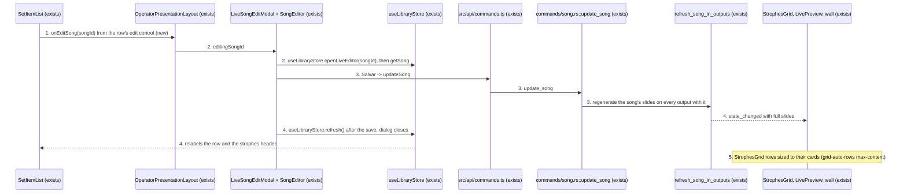
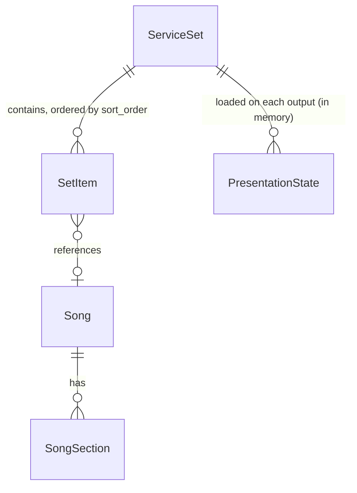
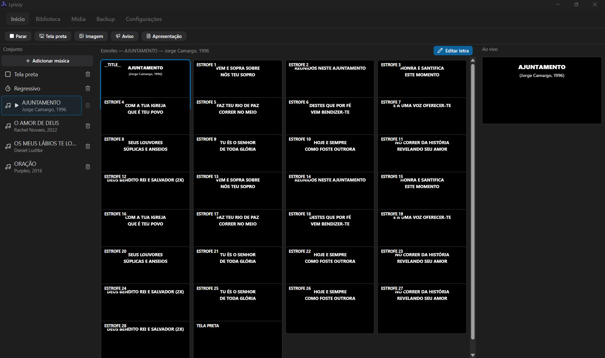

# Edit any song from the live set, and strophe cards that never overlap

**Approved**: 2026-10-28 - user: "ok, approved, keep going"

## Problem

While presenting, the only way to edit a song is `Editar letra` above the strophes pane, and it
opens the editor for the current item only. To fix a typo in the next song, the operator first
clicks that song in the set pane. That click is `goToItem` on the focused output
(`SetItemList.tsx:40`, `stores/presentation.ts:139`), so unless they froze the screen first, the
wall jumps to that song's first slide in front of the congregation. After saving, they click back
to the song that was playing. The editor itself already exists, and so does the live refresh of a
saved song on every screen (`update_song` → `refresh_song_in_outputs`, `presentation.rs:483`). What
is missing is a way to reach the editor without moving the wall.

A song with many slides breaks the strophes pane. The capture shows AJUNTAMENTO, a title card plus
28 strophes plus the closing black slide (30 cards, 4 columns), on a 1920×1140 window at 125%
scale. The rows land 95 CSS px apart while each card is 127 CSS px tall, so every card hides the
bottom quarter of the card above it. The strophe text on the hidden part is unreadable, and the
active card's highlight ring is cut off. The cause is in `StrophesGrid.tsx:212`. The grid rows are
`auto`, and each card's height comes from a percentage-padding spacer (`StrophesGrid.tsx:86`). The
grid counts that spacer as zero when it works out a row's minimum height. When the cards fit in
the pane, each row grows to the card's full height. When they do not fit, the grid divides the
pane's height among the rows: (744 − 7 × 8) / 8 = 86 px per row here, which matches the capture.
Reproduced in headless Chromium 151: 30 cards in a 944×760 pane give a 94 px row pitch for 126 px
cards and 26 overlapping pairs. With rows sized to their content (`grid-auto-rows: max-content`)
the pitch is 134 px and nothing overlaps. The earlier "16:10 overlap" fix (`596d96f`) fixed each
card's own ratio, but not the row height. A song short enough to fit the pane never shows the
problem, which is why it surfaces only with many slides.

When this ships, the operator edits any song in the set from its row, and the wall and the
selected item stay where they were. Every strophe card shows in full however many slides the song
has, and the pane scrolls to reach the rest. Both ship together as release `v1.9.0`.

## Shape

This reuses the editor dialog `Editar letra` opens (`LiveSongEditModal` around the unmodified
`SongEditor`, with the `openLiveEditor` flag that keeps the router on the presentation view),
`update_song`, and its `refresh_song_in_outputs` live refresh with the anchor rule that keeps the
strophe on screen. No second editor or refresh path is added. Two rules change an outcome. Which
rows get an edit control (the item type is `song`) and the fact that the control never navigates
are frontend rules `vitest` reaches (TESTING.md: component tests). The row height is CSS layout
that jsdom cannot compute. It is proven in a real Chromium: a picture against the capture, and a
walk at other sizes and counts.

1. the operator uses the edit control (new) on a song row -> `SetItemList` (exists) calls `onEditSong(songId)`, handed down by `OperatorPresentationLayout` (exists), which sets the same `editingSongId` the `Editar letra` button sets; nothing is sent to the backend and no `goToItem` runs
2. `LiveSongEditModal` (exists) -> `useLibraryStore.openLiveEditor(songId)` (exists) -> `SongEditor` (exists) loads the song with `getSong` and shows it in the dialog
3. the operator uses `Salvar` -> `updateSong` in `src/api/commands.ts` (exists) -> `commands/song.rs::update_song` (exists) persists `Song` and its `SongSection` rows, emits `songs_changed`, and runs `refresh_song_in_outputs` (exists), which regenerates the song's slides on every output whose loaded set holds it and keeps each output's item and slide
4. out: `state_changed` with the new slides to both windows, so `StrophesGrid`, `LivePreview` and the wall redraw; `SongEditor` calls `useLibraryStore.refresh()` (exists), which relabels the set pane row and the strophes header; the dialog closes
5. `StrophesGrid` (exists) - each row is as tall as its cards, so the pane scrolls when the cards do not fit; the active card still scrolls into view

**Changes underneath**

| Front | What changes |
| --- | --- |
| domain | `editingSongId` in `OperatorPresentationLayout` meant "the current item's song"; it now means "any song in the loaded set". Its readers: `LiveSongEditModal`, and `handleStop`, which clears it so the dialog closes on Parar |
| domain | `SetItemList` gains an edit callback beside its existing remove control. Its other caller, the read-only list (no `editable`), shows neither control and is unchanged |
| stored data | nothing to migrate. `songs` and `song_sections` rows are written by the existing `update_song`, as `Editar letra` does today |
| readers | every output whose loaded set holds the edited song, Tela 2 included (existing refresh); Home's set builder and the library list (existing `songs_changed` listeners in `OperatorApp` and `HomeSetBuilder`) |
| layout | `StrophesGrid` rows no longer shrink to fit the pane. With few slides nothing changes; with many, fewer rows fit and the pane scrolls. This applies to slideshows too, since they share the grid |

New: nothing - the existing `update_song` writes the same rows `Editar letra` writes today.
One-way constraints: none.

## Surface

None - nothing consumed outside. No Tauri command is added or changes its signature; the edit
control calls `getSong` and `updateSong`, which exist.

## Landing

None - no schema change, no migration, no new dependency, no new pattern. The row height is one
CSS property on one component, and the edit control reuses an existing dialog. The headless
Chromium used for the picture and the walk is a dev tool already on this machine
(`~/.cache/ms-playwright`). The repo does not gain it.

- Nothing else in this change is hard to reverse

## Criteria

### S1: Edit any song from the set pane (P1)

The operator fixes a song in the set without putting it on the wall.

**Acceptance Criteria**

1. WHILE presenting, the set pane SHALL show an edit control on every song row, the song on screen included, and on no row of another item type (countdown, blank, media, slideshow, camera, web page)
   - [Tela preta, Regressivo, AJUNTAMENTO (on air), O AMOR DE DEUS] → edit control on AJUNTAMENTO and O AMOR DE DEUS only; the read-only set list (not `editable`) → no edit control on any row
2. WHEN the operator uses the edit control on a song row THEN the system SHALL open the song editor dialog `Editar música` (the one `Editar letra` opens) loaded with that row's song, and SHALL NOT change the focused output's current item or slide, the set pane's highlight, or the strophes pane
   - live on AJUNTAMENTO strophe 5, edit O AMOR DE DEUS → the dialog shows O AMOR DE DEUS; no `go_to_item` is sent; the set pane still highlights AJUNTAMENTO and the strophes pane still shows AJUNTAMENTO
3. WHEN the operator uses `Salvar` in that dialog THEN the system SHALL save the song and close the dialog. Every output whose loaded set holds the song SHALL then show its new slides and stay on the item and slide it was on
   - O AMOR DE DEUS (not on air) gains a strophe, then the operator selects it → its strophes pane shows the new strophe; the wall stayed on AJUNTAMENTO strophe 5 throughout
   - AJUNTAMENTO (on air, strophe 5) has a word changed in strophe 5 → the wall shows the new word and stays on strophe 5
4. WHEN the operator changes a song's title or artist and saves THEN its set pane row SHALL show the new title and artist without a restart, and so SHALL the strophes header when it is the current item
5. WHEN the operator closes the dialog with its close control THEN the system SHALL write nothing and leave the set pane, the strophes pane and the wall as they were
6. WHEN the operator uses `Parar` while the dialog is open THEN the dialog SHALL close, as it does for `Editar letra` today
7. The `Editar letra` button SHALL keep opening the editor for the current item's song, and SHALL stay disabled when the current item is not a song

### S2: Strophe cards never overlap (P1)

Every strophe card shows in full, however many slides the song has.

**Acceptance Criteria**

8. WHILE a song or slideshow is the current item, the strophes pane SHALL show every slide card at 16:9 with no card overlapping another, and SHALL scroll vertically to reach cards that do not fit
   - 30 cards at the capture's window (1536×912 CSS px, 125% scale) → 0 overlapping cards, each card's height = its width × 9/16 (± 1 px), the last card reachable by scrolling
   - 60 cards at a 1280×720 window → 0 overlapping cards; 3 cards → the cards sit at the top of the pane at full height, as today
9. WHEN the current slide moves to a card outside the visible part of the pane (keyboard advance or the wall's own advance) THEN the strophes pane SHALL scroll that card into view
10. WHEN the operator presents a song with 30 slide cards THEN the system SHALL show the operator screen in `.specs/features/phase22-live-song-edit-grid/captures/operator-many-slides.png`, with the departures listed in `## Differences from the source`

### S3: Release v1.9.0 (P1)

Both changes reach every installation as one release.

**Acceptance Criteria**

11. The version SHALL read `1.9.0` in `package.json`, both `package-lock.json` fields, `src-tauri/tauri.conf.json`, `src-tauri/Cargo.toml` and `src-tauri/Cargo.lock`: `node scripts/check-version.mjs v1.9.0` exits 0
12. WHEN the Verifier's findings are closed and the gate is green THEN `main` and tag `v1.9.0` SHALL be pushed, the release workflow run for the tag SHALL succeed on Windows and Linux, the draft release SHALL be published, the publish-manifest workflow run SHALL succeed, and the repository's latest-release `latest.json` SHALL serve version `1.9.0`
13. The project roadmap (`.specs/project/ROADMAP.md`) SHALL carry a Phase 22 entry marked released as `v1.9.0`

## Out of scope

| Excluded | Why |
| --- | --- |
| An edit control on non-song rows (countdown, media, slideshow, camera, web page) | not requested; each has its own editor on Home, and none has lyrics |
| A confirm step before the editor or before saving | the user chose the editor directly, with `Salvar` as the confirmation (AD-091) |
| The editor's `Excluir` (delete the song from the library) inside the live dialog | it is already there in `Editar letra`'s dialog today; this feature does not change it |
| Editing a song from Home's set builder | it already has an edit action (`builder.actions.editSong`) |
| Card size, column count or a zoom control for the strophes pane | not requested; the fix keeps the 220 px minimum card width and the 8 px gap |
| A keyboard shortcut for the row edit control | a new capability; the key-binding table would need a new action |
| Changing the editor dialog itself | it is reused unmodified |

## Assumptions

| Assumption | Chosen default | Rationale | Confirmed? |
| --- | --- | --- | --- |
| What the row's edit control opens | The song editor dialog `Editar letra` opens, loaded with that song; `Salvar` confirms, the close control discards | user: "Editor directly (Recommended)" | y |
| Which songs get the edit control | Every song row, the song on screen included; saving the song on screen updates the wall and keeps its strophe | user: "Every song, on-air too (Recommended)" | y |
| One release, and doing it | Both changes ship together, and the release is pushed, built, published and checked by this run once verification is green (AC 12) | user: "Add these two features in one release and do the release" | y |
| Who publishes the draft release | The agent pushes `main` and `v1.9.0`; the user publishes the draft on GitHub once CI has built both installers; the agent then confirms the tag and the published `latest.json` (C17, C18) | user, 2026-10-28, after learning `gh` is absent and the API is rate-limited: "You publish, I confirm (Recommended)" | y |
| Release version | `1.9.0` | a minor bump for new features, as `1.7.0` → `1.8.0` was | n |
| Edit control label | tooltip `Editar música` (en-US `Edit song`), accessible name `Editar música <title>`; a pencil icon at the size of the row's remove control, placed left of it | reuses the dialog's own title (`presentation.liveEdit.title`); matches the remove control's `<label> <name>` pattern | n |
| Row height fix | rows sized to their content (`grid-auto-rows: max-content`) on the existing grid; the scroller and `scrollIntoView` stay as they are | the smallest change that removes the cause, confirmed in headless Chromium; a flex-wrap rewrite would change column behaviour | n |

**Open questions:** none - all resolved or logged above.

## Differences from the source

| Source shows | Product shows | Confirmed |
| --- | --- | --- |
| Song rows in the `Conjunto` pane with the remove control only | Song rows with an edit control (pencil) left of the remove control, so in the 240 px pane a song's title and artist truncate about 30 px sooner (`OS MEUS LÁBIO…`, `Jorge Camargo, …` on the row on screen); `Tela preta` and `Regressivo` rows unchanged | y - AD-091 |
| Strophe cards overlapping: rows 95 CSS px apart for 127 CSS px cards, each card hiding the bottom of the one above | Rows as tall as their cards, so no card overlaps another; fewer rows fit and the pane scrolls | y - AD-092 |

## Sources

- User request, 2026-10-28 - "add a way to edit the song besides the existing one method that I can edit without switch to the set list ... add a small button to edit and open a dialog to confirm, also add to these feature the fix of song 'slides' show overflowing another when it has a large number of slides ... Add these two features in one release and do the release" - the scope
-  - binding - the operator presentation screen at 1920×1140 px, 125% scale (1536×912 CSS px), presenting a 4-song set with AJUNTAMENTO's 30 cards. It is the layout to keep, minus the two departures above. Its top strip (the `Lyrizzy` title and the window buttons) is the Windows title bar, drawn by the OS outside the webview
- `.specs/project/STATE.md` D-88 (live set edits on every output) and `.specs/STATE.md` AD-091, AD-092 - the decisions this conforms to
- `docs/release.md` - the release flow AC 11 and 12 follow
