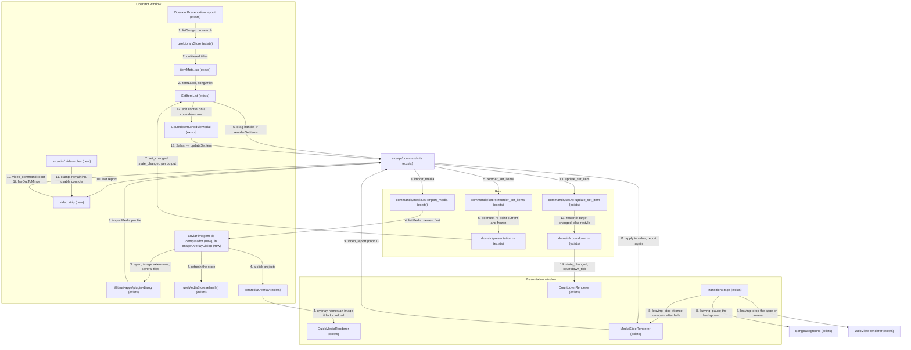
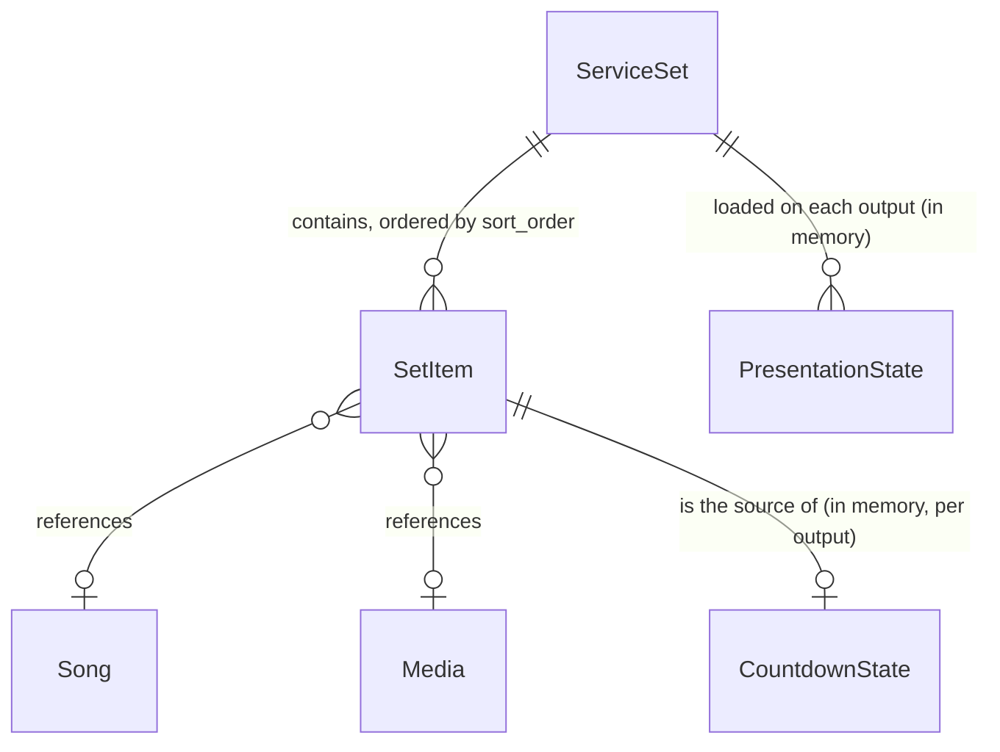
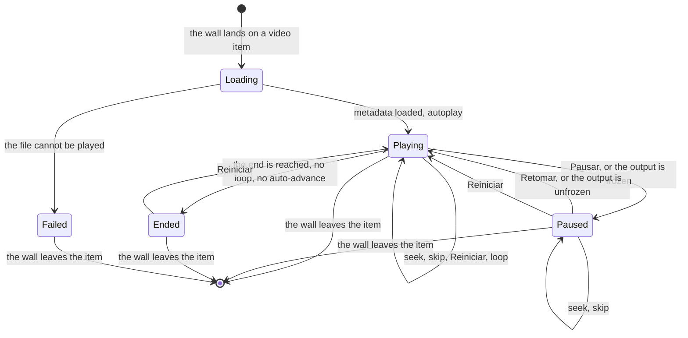

# Presenter mode: song names, image upload, reorder, video controls, countdown editor

**Approved**: 2026-11-16 - user: "approved, keep going"

## Problem

Five things go wrong or are missing for the operator while presenting. The request gives no
capture, log or reproduction steps; the causes below were found in the code.

**Song names turn into "—".** The set pane and the strophes header resolve a song's title from
`useLibraryStore.songs` (`itemMeta.tsx:70`), and that list is the Biblioteca view's search result:
`refresh` sends the store's `search` text to `list_songs` (`stores/library.ts:57`). The presenter
reloads the list only when it is empty (`OperatorPresentationLayout.tsx:96`). So after the operator
searches the library for "amor" and then presents, every song in the set that does not match
"amor" is absent from the list and its row shows the fallback "—". The same filtered list feeds
`Adicionar música`, which then offers only the matching songs, and a live song save calls
`refresh()` with the stale search and shrinks the list again.

**The `Imagem` dialog cannot take a new photo.** It lists images already in the media library
(`OperatorPresentationLayout.tsx:292`). A photo that arrives during the service has to be imported
on the Mídia tab, which is locked while presenting, so the operator must stop the presentation.

**Set items cannot be reordered.** Home reorders with drag and drop; the presenter's set pane only
adds songs and removes items. Phase 21 left reorder out because it needs its own anchoring rules.

**A video keeps playing after the wall leaves it.** `TransitionStage` crossfades two layers and
never unmounts the one that faded out (`TransitionStage.tsx:63`): it stays in the tree at opacity 0
until the *next* change replaces it. A video item's `<video>` therefore keeps playing, with sound
and looping when the item loops, behind a `Tela preta` item or a song. The operator also has no
view of the video: no elapsed or remaining time, no pause, no restart.

**A countdown cannot be edited while presenting.** The strip added in phase 21 moves the running
time by `+1/+5/−1 min`, pauses and restarts. The message, the configured time, the clock-time
target, the sizes, the position, the background and the end action are editable only on Home.

When this ships, every song row keeps its title whatever the library search holds; the operator
uploads a photo from inside the `Imagem` dialog; drags set rows into a new order without moving
the wall; sees a video's time and pauses, restarts, seeks, skips and mutes it, and a video stops
the moment the wall leaves it; and edits any countdown in the set from its row. All five ship
together as release `v1.10.0`.

## Shape

This reuses `list_songs`, `import_media`, `reorder_set_items`, `update_set_item` and their stores,
`@dnd-kit/sortable` as Home's `SetBuilder` uses it, the `CountdownScheduleModal` dialog, the
`fanOutToMirror` helper and the `forward_keydown` pattern for window-to-window events; no second
editor, importer or reorder path is added. The rules that change an outcome run in two layers the
tests reach: the reorder anchoring, the permutation check and the countdown-edit rule are pure
Rust in `domain/` (`cargo test`); title resolution, the upload flow, drag-to-command, the video
rules (clamp, remaining, which control is usable) and the layer unmount are frontend functions and
components (`vitest`). Real video playback is not computed by jsdom, so a video stopping on the
wall is also walked in a real Chromium.

1. the operator presents -> `OperatorPresentationLayout` (exists) loads the song titles through `useLibraryStore` (exists) from `listSongs()` with no `search`, kept apart from the Biblioteca view's filtered `songs`, and reloads them on `songs_changed`
2. `itemLabel` and `songArtist` in `itemMeta.tsx` (exists) resolve from that unfiltered list -> `SetItemList`, the strophes header and `LiveSongPicker` (exist)
3. the operator uses `Enviar imagem do computador` (new) in `ImageOverlayDialog` (new), the `Imagem` dialog `OperatorPresentationLayout` (exists) opens -> `open` from `@tauri-apps/plugin-dialog` (exists), image extensions, several files -> `importMedia` in `src/api/commands.ts` (exists), one call per file -> `commands/media.rs::import_media` (exists) copies the file, persists `Media` and emits `media_library_changed`
4. `ImageOverlayDialog` (new) lists the images itself with `listMedia` (exists), newest first, so the new ones lead its grid whatever the Mídia view filters; it also runs `useMediaStore.refresh()` (exists) for the rest of the operator window; a click on one calls `setMediaOverlay` (exists), as today, and the wall's `QuickMediaRenderer` (exists) reloads its own media list when the overlay names an image it has not loaded
5. the operator drags a row's handle (new) in `SetItemList` (exists) -> `reorderSetItems` in `src/api/commands.ts` (exists) -> `commands/set.rs::reorder_set_items` (exists)
6. `reorder_set_items` (exists) checks the ids are a permutation of the set's items, writes `SetItem.sort_order`, and for every output with the set loaded reorders `set.items` and `presentation_slides` and re-points `current_item_index` and `frozen_at` at the same items; the rule is a pure function in `domain/presentation.rs` (exists), beside `splice_insert` and `splice_remove`
7. out: `set_changed` and one `state_changed` per output to both windows; no wall changes what it shows
8. the wall changes item -> `TransitionStage` (exists) tells the outgoing layer it is leaving, so `MediaSlideRenderer`, `SongBackground` and `WebViewRenderer` (exist) stop its video, background or page at once, and unmounts that layer when its fade ends; a change within the same item (the next strophe) updates in place
9. `MediaSlideRenderer` (exists) on the wall emits `video_report` (door 1) through `src/api/commands.ts` (exists) from its `<video>` element's events
10. the video strip (new) in `OperatorPresentationLayout` (exists) shows the focused output's last report; a control emits `video_command` (door 1) through `src/api/commands.ts`, also to the other output while Simultânea is on (`fanOutToMirror`, exists)
11. `MediaSlideRenderer` (exists) applies the command to its `<video>` and reports again (hop 9); the clamp and control rules are pure functions in `src/utils/` (new), as `countdownControls.ts` is
12. the operator uses the edit control (new) on a countdown row in `SetItemList` (exists) -> `OperatorPresentationLayout` (exists) opens `CountdownScheduleModal` (exists) with that item; nothing is sent to the backend
13. `Salvar` -> `updateSetItem` in `src/api/commands.ts` (exists) -> `commands/set.rs::update_set_item` (exists) persists `SetItem.countdown_config`, patches the item in every loaded set (exists), then applies the edit to every output whose `CountdownState.source_item_id` is this item: restart from the new target when the target changed, otherwise keep counting and copy the look; the rule is a pure function in `domain/countdown.rs` (exists), beside `adjusted` and `restart`
14. out: `state_changed` and `countdown_tick` -> `CountdownRenderer` on the wall, `LiveCountdownControls` and the row label (exist)

**Changes underneath**

| Front | What changes |
| --- | --- |
| domain | The presenter's song titles came from `useLibraryStore.songs`, which means "the Biblioteca view's current search result". They now come from an unfiltered list. Who reads `songs` today while presenting: `SetItemList`, `OperatorPresentationLayout` (strophes header), `StrophesGrid`, `OutputLaunchModal`, `LiveSongPicker`, `OperatorNotesPanel`, `SlideController`; each one that labels a set item moves to the unfiltered list. The Biblioteca view (`SongList`) keeps the filtered `songs` and its search text |
| domain | `TransitionStage`'s back layer meant "the previous content, kept mounted until the next change". It now means "the previous content, only while it fades out", and its renderers know it is leaving (`useLayerActive`): a video item pauses, a song's or countdown's video background pauses, a web page or camera is dropped. A change within the same item (the next strophe, or an index shift) now updates in place instead of crossfading - the old stage did the same in effect, reusing the front layer's elements, which is what kept a song's video background playing across strophes (C72). Both cut on screen: the incoming layer is opaque and on top at once. Its only user is `PresentationApp` |
| domain | `reorder_set_items` wrote `sort_order` and emitted `set_changed`. It now also reorders the set in every output that has it loaded, and refuses a list that is not a permutation of the set's items. Its callers: Home's `SetBuilder` and `HomeSetBuilder`, which always send the full list |
| domain | `update_set_item` with a `countdownConfig` patched the loaded sets. It now also restarts or restyles a countdown counting from that item (AD-093). Its callers: `CountdownScheduleModal` (Home, the scheduled widget's `Editar`, and now the presenter), `OperatorApp.handleCancelSchedule`, the item editors on Home |
| domain | `CountdownScheduleModal` on save armed the schedule, or else reset the output's countdown. Opened while presenting it must not reset or re-arm over a countdown that is counting on the wall (criteria 39-41). On Home it arms and resets as today. On both, a refused save now shows its error in the dialog and keeps it open; it used to close nothing and log only |
| domain | The wall's transition key was "item index + slide"; it is now "item id + slide", so a live reorder, add or remove that only shifts the current item's index no longer re-runs the transition, which would remount a playing video (C66). Its only reader is `PresentationApp` |
| domain | The wall's media list (`useMediaStore` in the presentation window) was loaded once, when the window opened. `QuickMediaRenderer` now reloads it once when the overlay names a media id it does not hold (C65). Its readers: the image overlay and the countdown and media renderers, which only gain a fuller list |
| domain | `useLibraryStore.refresh()` under a Biblioteca search now also reloads the unfiltered list (a second `list_songs`), so the presenter's titles stay current after a library save |
| domain | D-89 said no live control writes `set_items.countdown_config`. The row editor is a new path that does (AD-093); the strip's `+1/+5/−1 min` stays run-only |
| stored data | nothing to migrate. `set_items.sort_order`, `set_items.countdown_config` and `media` rows are written by the existing commands in their existing shapes |
| readers | every output whose loaded set is reordered or holds the edited countdown, Tela 2 and a frozen wall included; Home's set builder (existing `set_changed` listener) shows the new order and the edited countdown after `Parar`; the Mídia tab shows images uploaded from the `Imagem` dialog; the scheduled-countdown widget, whose armed reference is an item index (criterion 22) |

New: nothing stored - no table, column or relation is added. One-way constraints: none.

## Surface

None - nothing consumed outside the app's own two windows. No Tauri command is added and none
changes its signature. `reorder_set_items` gains one refusal, `set.reorder_mismatch` (criterion 20),
and `update_set_item` gains one, `countdown.target_passed` (criterion 44); both get a pt-BR and an
en-US message in the error table. The two new frontend events, `video_report` (emitted by a
presentation window, read by the operator window) and `video_command` (emitted by the operator
window, obeyed only by the presentation window of that `output` showing that `itemId`), are door 1
in `Landing`.

## Landing

| One-way door | Literal shape | Alternative rejected |
| --- | --- | --- |
| 1. Video playback crosses windows as two frontend events, wrapped in `src/api/commands.ts` and listed in CLAUDE.md's IPC contract (AD-094) | `video_report`: `{ output: "one" \| "two", itemId: string \| null, status: "loading" \| "playing" \| "paused" \| "ended" \| "failed", positionMs: number, durationMs: number \| null, muted: boolean }`; `itemId: null` means no video is on that wall. `video_command`: `{ output, itemId, action: { kind: "pause" } \| { kind: "resume" } \| { kind: "restart" } \| { kind: "seek", positionMs: number } \| { kind: "skip", deltaMs: number } \| { kind: "mute", muted: boolean } }` | A playback clock in `AppState`, as the countdown has: it cannot see the element's real position, and has no duration when ffprobe is missing (`Media.durationMs` is optional). A `report_video_progress` Tauri command: the presentation window would invoke a mutating command, against the read-only invariant |

- Nothing else in this change is hard to reverse: no schema, no migration, no new dependency (`@dnd-kit` is already installed)

## Criteria

### S1: Song rows keep their titles (P1)

Every song in the set shows its title while presenting, whatever the library search holds.

**Acceptance Criteria**

1. WHILE presenting, every song row in the set pane SHALL show that song's title and artist, whatever text the Biblioteca search box holds
   - library searched for "amor", set [AJUNTAMENTO, O AMOR DE DEUS] → both rows show their titles; searched for "zzz" (no match) → both rows show their titles; no search → both rows show their titles
2. WHILE presenting, the strophes header and the remove confirmation SHALL name the song by its title under the same condition
   - library searched for "amor", AJUNTAMENTO on screen → the header reads `Estrofes — AJUNTAMENTO — <artist>`, not `Estrofes — —`
3. WHEN the operator opens `Adicionar música` THEN the picker SHALL list every song in the library, whatever text the Biblioteca search box holds
   - library searched for "amor", 3 songs in the library → the picker lists 3 songs
4. WHEN a song is saved or created while presenting THEN the set pane SHALL show its current title without a restart, with a Biblioteca search still set
   - library searched for "amor", AJUNTAMENTO renamed to AJUNTAMENTO 2 in the live editor → its row reads AJUNTAMENTO 2
5. WHEN the operator returns to Biblioteca after presenting THEN the view SHALL still show its search text and only the songs matching it
6. IF a set item references a song that is not in the library at all THEN its row SHALL show "—", as today

### S2: Upload a photo from the `Imagem` dialog (P1)

The operator adds a photo from the computer without leaving the presentation.

**Acceptance Criteria**

7. WHEN the operator uses `Imagem` THEN the dialog `Selecionar imagem` SHALL show the control `Enviar imagem do computador` above the grid, the library holding images or none
8. WHEN the operator uses `Enviar imagem do computador` THEN the system SHALL open the computer's file dialog, limited to `png`, `jpg`, `jpeg`, `webp` and `gif`, allowing several files
9. WHEN the operator picks files THEN each one SHALL be imported into the media library, and the dialog SHALL stay open and show the new images first in its grid; nothing SHALL be projected by the upload
   - 2 photos picked → 2 `import_media` calls, 2 new thumbnails first in the grid, no `set_media_overlay` call; the Mídia tab lists both after `Parar`
10. WHEN the operator clicks an uploaded image in the grid THEN the system SHALL project it as the overlay and close the dialog, as for any image there today
11. WHILE files are being imported, the upload control SHALL be disabled and show the progress `Importando 1/2…`
12. IF a picked file fails to import THEN the dialog SHALL import the others, stay open, and show an alert with the number of files not imported
    - 3 picked, the second fails with `media.copy_error` → 2 new thumbnails, alert `1 arquivo não foi importado`
13. WHEN the operator cancels the file dialog THEN nothing SHALL be imported and the `Imagem` dialog SHALL stay as it was

### S3: Reorder set items by drag and drop (P1)

The operator changes the order of the set without moving the wall.

**Acceptance Criteria**

14. WHILE presenting, every row in the set pane SHALL show a drag handle, the row on screen included; the read-only set list (not `editable`) SHALL show none
15. WHEN the operator drags a row by its handle and drops it on another position THEN the set pane SHALL show the new order, the order SHALL be saved to the set, and Home's set builder SHALL show the same order after `Parar`
    - [A, B, C, D], drag D onto B's position → [A, D, B, C]; `reorder_set_items` receives the ids in that order
16. WHEN a reorder is saved THEN every output that has that set loaded SHALL keep showing the item and slide it showed, and a frozen output SHALL keep its frozen item and slide; the set pane's highlight SHALL stay on the same item
    - live on B strophe 3 in [A, B, C], move C before A → [C, A, B], the wall still shows B strophe 3 and the highlight is on B (now third)
    - move the row on screen itself: live on B, drag B to the end → [A, C, B], the wall still shows B strophe 3
    - Tela 1 live on B, Tela 2 live on C, same set, move A to the end → Tela 1 still B, Tela 2 still C
    - frozen on A slide 2 while the operator browses C, move A to the end → the wall still shows A slide 2
17. WHEN the order has changed THEN next and previous SHALL follow the new order
    - [A, C, B] with B on screen at its last slide: next → stays on B (end of set); previous from B's first slide → C's last slide
18. WHEN the operator presses and releases a row without moving it, or clicks its title THEN the system SHALL select that item as today; WHEN the operator drags by the handle THEN no `go_to_item` SHALL be sent
19. WHEN the operator focuses a drag handle and uses Space, the arrow keys and Space THEN the row SHALL move as with the pointer, as Home's set builder allows
20. IF the id list sent is not a permutation of the set's current items (one missing, one unknown, one twice) THEN `reorder_set_items` SHALL refuse it with `set.reorder_mismatch` and change neither the stored order nor any output
    - set [A, B, C]: [A, B] → refused; [A, B, C, X] → refused; [A, A, B] → refused; [C, B, A] → saved
21. IF saving a reorder fails THEN the set pane SHALL return to the stored order and show the error in the pane's alert line
22. WHEN a reorder moves a countdown item whose schedule is armed THEN the scheduled-countdown widget's `Editar` and `Cancelar` SHALL still act on that countdown item
    - [Song, Countdown (armed 19:00), Song], move Countdown first → `Editar` opens that countdown's dialog, not the song's
23. The set pane SHALL keep its 240 px width (AD-091) and SHALL show each row's handle, title and its edit and remove controls at window sizes 1024×700 and 1536×912

### S4: A video stops when the wall leaves it, and the operator controls it (P1)

A video never plays behind another item, and the operator sees and drives its playback.

**Acceptance Criteria**

24. WHEN the wall's current item changes away from a video item THEN that video SHALL be paused, and so silent, in the same update, and its `<video>` element SHALL be gone from the page no later than the transition time plus 30 ms
    - video (loop on) → `Tela preta` item at 200 ms transition: paused at once, no `<video>` after 230 ms; video → song: the same; transition 0 ms: no `<video>` at once
    - video A → video B: A stops, B plays from 00:00
    - `Tela preta` item → back to the video: it plays again from 00:00
25. The same SHALL hold for any item that leaves the wall: a camera or web page item, and a song or countdown with a video background, SHALL not keep running behind the item that replaced it
26. WHILE the focused output's wall shows a video set item, the operator SHALL see a video strip with the elapsed and total time `01:05 / 03:20`, the remaining time `−02:15`, a progress bar, `Pausar` or `Retomar`, `Reiniciar`, `−10 s`, `+10 s` and `Silenciar` or `Ativar som`; it SHALL be reachable at window sizes 1024×700 and 1536×912
27. WHILE the wall shows no video set item (another item, blackout, an overlay or a countdown takeover covering it, or not presenting), the strip SHALL not be shown
    - video item → next item: the strip goes; blackout on a video item: the strip goes; `Parar`: the strip goes
28. WHILE a video plays on the wall, the strip's times and bar SHALL follow it, no more than 500 ms behind
    - a 03:20 video at 01:05 → `01:05 / 03:20`, `−02:15`, bar at 32.5%
29. WHEN the operator uses `Pausar` THEN the wall's video SHALL pause on its frame and the control SHALL read `Retomar`; WHEN the operator uses `Retomar` THEN it SHALL continue from the same position
30. WHEN the operator uses `Reiniciar` THEN the wall's video SHALL play from 00:00, whether it was playing, paused or ended
31. WHEN the operator uses `−10 s` or `+10 s` THEN the position SHALL move by 10 000 ms, clamped to the video
    - at 00:04, `−10 s` → 00:00; at 03:15 of 03:20, `+10 s` → 03:20, and the item's own end rule applies (loop restarts, auto-advance goes to the next item, otherwise it holds the last frame)
32. WHEN the operator clicks the progress bar, or drags on it and releases THEN the wall's video SHALL jump to that fraction of its duration; while dragging, the strip SHALL show the target time and the wall SHALL not move until release
    - click at 25% of a 03:20 video → 00:50
33. WHEN the operator uses `Silenciar` THEN the wall's video SHALL be muted for this run and the control SHALL read `Ativar som`; the item's saved mute option SHALL not change, and the strip SHALL open on the saved option each time the wall lands on the item
34. WHILE Simultânea (mirror) is on, each video control SHALL act on both outputs; the strip SHALL show the focused output's video
35. WHILE the output is frozen, the video SHALL stay paused, as today, and `Pausar`/`Retomar`, `Reiniciar`, `−10 s`, `+10 s` and the bar SHALL be disabled
36. IF the video's duration is not known yet THEN the strip SHALL show `--:--` for the total and the remaining time and SHALL disable the bar, `−10 s` and `+10 s`
37. IF the wall's video cannot be played THEN the strip SHALL show `Não foi possível reproduzir o vídeo` and disable every control
38. WHEN a video with no loop and no auto-advance ends THEN the strip SHALL show the remaining time `−00:00` and `Reiniciar` SHALL stay usable; `Pausar`/`Retomar` SHALL be disabled

### S5: Edit a countdown from its set row (P1)

The operator changes any countdown in the set while presenting, the one on the wall included.

**Acceptance Criteria**

39. WHILE presenting, the set pane SHALL show an edit control on every countdown row, the countdown on screen included; song rows SHALL keep theirs (AD-091), and no other item type SHALL get one
    - [Tela preta, Regressivo (on air), AJUNTAMENTO, a video] → edit control on Regressivo and AJUNTAMENTO only
40. WHEN the operator uses the edit control on a countdown row THEN the system SHALL open the dialog `Configurar cronômetro` that Home uses, loaded with that item's name, duration or clock time, message, text sizes, end action, background, position and schedule, and SHALL NOT change the current item, the wall or the running time
41. WHEN the operator uses `Salvar` THEN the item SHALL be saved to the set and the dialog SHALL close; a countdown that is not counting from that item on any output SHALL change nothing on any wall, and SHALL use the new configuration the next time it starts
42. WHEN the saved item is the source of a countdown that is running, paused or finished on an output, and its target did not change THEN that countdown SHALL keep its mode and remaining time, and the wall SHALL show the new message, sizes, position and background within one second
    - 10:00 countdown at 03:12, message changed → still counting from 03:12 (± 1 s) with the new message
    - paused at 02:00, position changed → still paused at 02:00, drawn at the new position
    - end action changed from hold to blackout at 03:12 → still 03:12; at 00:00 it blacks out
43. WHEN the saved item is the source of a countdown that is running, paused or finished on an output, and its target changed THEN that countdown SHALL restart running from the new target on every output it is counting on, dropping the strip's adjustments
    - 10:00 at 03:12, duration changed to 07:30 → running from 07:30
    - paused at 02:00, duration changed to 05:00 → running from 05:00
    - finished at 00:00, duration changed to 01:00 → running from 01:00
    - duration 10:00 changed to clock time 19:30 at 19:10 → running towards 19:30 (20:00 left)
    - the same duration typed again (`10:00` → `10:00`) with a new message → not restarted (criterion 42)
44. IF the new target is a clock time that has already passed today, and the item is the source of a countdown counting on an output THEN the save SHALL be refused with `countdown.target_passed`, nothing SHALL be written, and the dialog SHALL stay open showing the error
    - at 19:40, clock time 19:30 on the countdown on the wall → refused; the same edit on a countdown not counting anywhere → saved
45. WHEN the operator saves a new name THEN the countdown's set row SHALL show it without a restart
46. WHILE a countdown is running or paused on the focused output, the dialog's schedule fields SHALL be disabled with the note `Indisponível enquanto um cronômetro está em andamento`, and a save SHALL keep the item's stored schedule and SHALL NOT arm, re-arm or reset any countdown
47. WHILE no countdown is running or paused on the focused output, the dialog's schedule fields SHALL work as on Home: a save with a schedule arms it, and a save that turns off this item's armed schedule disarms it; a schedule armed for another item SHALL not be disarmed
48. WHEN the operator closes the dialog with `Cancelar` THEN nothing SHALL be written and no wall SHALL change; WHEN the operator uses `Parar` while the dialog is open THEN the dialog SHALL close
49. The `+1 min`, `+5 min`, `−1 min`, `Pausar`/`Retomar` and `Reiniciar` strip SHALL keep working as today and SHALL stay run-only (D-89); after an edit that changed the target, `Reiniciar` SHALL return to the new target

### S6: Release v1.10.0 (P1)

All five changes reach every installation as one release.

**Acceptance Criteria**

50. The version SHALL read `1.10.0` in `package.json`, both `package-lock.json` fields, `src-tauri/tauri.conf.json`, `src-tauri/Cargo.toml` and `src-tauri/Cargo.lock`: `node scripts/check-version.mjs v1.10.0` exits 0
51. WHEN the Verifier's findings are closed and the gate is green THEN `main` and tag `v1.10.0` SHALL be pushed, the release workflow run for the tag SHALL succeed on Windows and Linux, the draft release SHALL be published, the publish-manifest workflow run SHALL succeed, and the repository's latest-release `latest.json` SHALL serve version `1.10.0`
52. The project roadmap (`.specs/project/ROADMAP.md`) SHALL carry a Phase 23 entry marked released as `v1.10.0`, and CLAUDE.md's IPC contract SHALL list `video_report` and `video_command`

## Out of scope

| Excluded | Why |
| --- | --- |
| Video controls for a song's or a countdown's background video, and for the camera | the request names a video added to a set; a background loops silently behind text |
| A loop toggle, a volume slider or playback speed | not requested; the user chose seek, skip and mute as the extras |
| Keeping a video's position when the wall leaves and returns, or under blackout, an overlay or a takeover | existing behaviour: the wall unmounts the item and it plays from 00:00 on return; not requested |
| Video in the operator's live preview pane | existing behaviour: it shows a static card for a video; the strip carries the playback state |
| Keyboard shortcuts for the video controls and for reorder beyond the drag handle's own keys | a new capability; the key-binding table would need new actions |
| Uploading a video or a presentation from the `Imagem` dialog | the dialog projects images; `Apresentação` already imports presentations |
| Dragging files from the desktop onto the `Imagem` dialog | the request names uploading from the local directory; Mídia's dropzone also opens the file dialog on drop |
| Renaming or deleting media from the `Imagem` dialog | the Mídia tab owns it |
| Reordering by dragging across sets, or dragging a library song into the set | not requested; `Adicionar música` adds songs |
| Keeping the armed schedule's reference right after a live add or remove | existing behaviour since phase 21; this feature fixes it for reorder only (criterion 22) |
| Edit controls on media, slideshow, camera, web page and blank rows | not requested |
| Restyling or restarting a fired schedule takeover by editing its item | a takeover is detached from its item (`source_item_id` is none, D-86); the scheduled widget's `Editar` owns it |
| Changing the countdown dialog's fields or layout | it is reused; only its save path and its schedule fields' availability differ while presenting |
| The song search on Biblioteca, Home's set builder and Home's song pickers | they keep their own lists; only the presenter's title resolution changes |

## Assumptions

| Assumption | Chosen default | Rationale | Confirmed? |
| --- | --- | --- | --- |
| What "full editing" of the countdown is | A pencil on every countdown row opens Home's `Configurar cronômetro` dialog; saving writes the set item (AD-093) | user, 2026-11-16: "Home's editor, saved (Recommended)" | y |
| A save while that countdown counts on the wall | Restart from the new target only when the duration or clock time changed; otherwise keep counting and restyle (AD-093) | user, 2026-11-16: "Restart only if time changed (Recommended)" | y |
| After picking a new photo in the `Imagem` dialog | It is imported and shown first in the grid; the operator clicks it to project; several files may be picked | user, 2026-11-16: "Add to the grid, I click it (Recommended)" | y |
| Video controls beyond time, bar, pause/resume and restart | Seek on the bar, `−10 s` / `+10 s`, mute/unmute (AD-094) | user, 2026-11-16: "Seek on the progress bar, Skip -10 s / +10 s, Mute / unmute" | y |
| Cause of the "—" names | The presenter reads the Biblioteca view's search-filtered song list; the fix resolves titles from an unfiltered list | found in the code (`stores/library.ts:57`, `OperatorPresentationLayout.tsx:96`); the request gives no reproduction, so another cause would need one | n |
| Live reorder is saved, and the row on screen may be moved | Saved to the set and applied to every output with it loaded; any row moves, the one on screen included (AD-095) | D-88 already saves live adds and removes; moving a row never changes what a wall shows | n |
| The schedule fields while a countdown is counting on that screen | Disabled, stored schedule kept (criterion 46) | an output holds one countdown: arming a schedule replaces the one counting on the wall, which Home's save would do | n |
| Live video controls are run-only | Pause, position and mute are not saved; each landing starts from 00:00 with the item's saved options | as D-89 for the countdown strip | n |
| Release version | `1.10.0` | a minor bump for new features, as `1.8.0` → `1.9.0` was | n |
| Who publishes | The agent pushes `main` and `v1.10.0` once the gate is green and the user says go; the user publishes the draft on GitHub; the agent then checks the tag and `latest.json` | the flow the user chose for `v1.9.0` (2026-10-28: "You publish, I confirm"); a push needs its own go-ahead | n |
| New labels | pt-BR / en-US: `Enviar imagem do computador` / `Upload image from computer`; `Importando 1/2…` / `Importing 1/2…`; `1 arquivo não foi importado` / `1 file was not imported`; drag handle `Reordenar <name>` / `Reorder <name>`; strip `Vídeo` / `Video`, `Pausar`, `Retomar`, `Reiniciar` (the countdown strip's words), `−10 s`, `+10 s`, `Silenciar` / `Mute`, `Ativar som` / `Unmute`, bar `Posição do vídeo` / `Video position`, `Não foi possível reproduzir o vídeo` / `The video could not be played`; row control `Editar cronômetro` / `Edit countdown`; `Indisponível enquanto um cronômetro está em andamento` / `Unavailable while a countdown is running` | no source draws them; they follow the neighbouring controls' wording | n |
| Mutation count | 5, one per slice S1-S5 | five independent rules; the default 3 would leave two slices unprobed | n |

**Open questions:** none - all resolved or logged above.

## Sources

- User request, 2026-11-16 - "generate a new release with these features and fixes below - Fix an issue where some songs in "presenter mode" glitched, resulting in their names being replaced by a hyphen ("-"); The image button in "presenter mode" should allow for uploading a new photo from the local directory when the modal is opened, rather than being limited to previously uploaded images; Enable the ability to drag and drop items within the set in "presenter mode" to reorganize their hierarchy; When a video is added to a set and started in "presenter mode," switching to a "black screen" item causes the screen to update correctly, but the video continues to play in a loop in the background. This should not happen; changing the item should remove focus from the video and stop it immediately. Additionally, "presenter mode" lacks feedback on video progress—such as time remaining, pause, restart, etc.; Add full editing capabilities for the countdown timer while in "presenter mode."" - the scope. No capture came with it, so no screen binds
- `.specs/project/STATE.md` D-86 (countdown source item), D-88 (live set edits on every output), D-89 (run-only countdown strip) and `.specs/STATE.md` AD-091, AD-093, AD-094, AD-095 - the decisions this conforms to
- `docs/release.md` - the release flow criteria 50 and 51 follow
