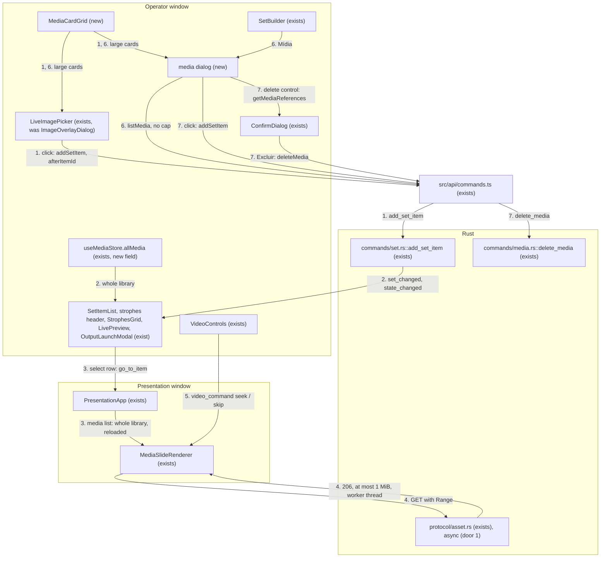
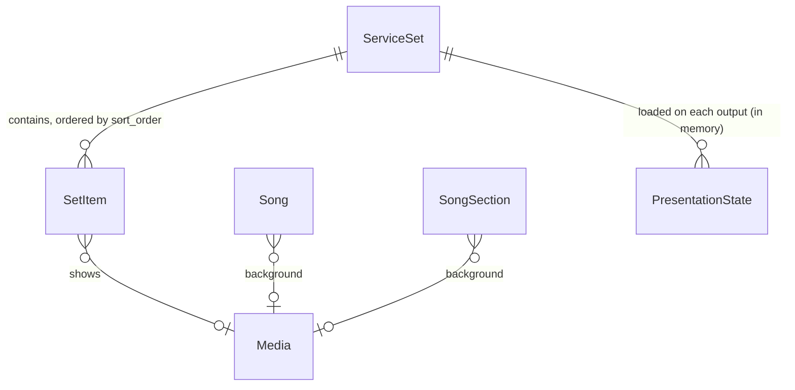

# Presenter image to the set, video seeking on Windows, Home media dialog

**Approved**: 2026-11-17 - user: "approved, keep going"
**Approved** (S6, added after the release): 2026-11-18 - user: "published the release, fix the countdown tests too"

## Problem

The user tested v1.10.0 on Windows and reported three things on 2026-11-17. No capture, log or
reproduction steps came with the report; the causes below were found in the code and reproduced in
headless Chromium, the engine WebView2 embeds (scripts in `repro/`).

**The presenter's `Imagem` projects the image instead of adding it to the set.** A click in the
`Imagem` dialog (`ImageOverlayDialog`) calls `setMediaOverlay` on the focused output and its mirror
(`OperatorPresentationLayout.tsx:195`): the image covers the wall until `Fechar overlay`, it never
enters the set, and the operator cannot return to it or move it. Two readers would also fail an
image added to the set mid-service. The wall's media list (`useMediaStore` in the presentation
window) loads once, when its window opens (`PresentationApp.tsx:128`), with `list_media`'s default
cap of the 200 newest items; only an overlay reloads it (phase 23 C65), so a set item naming an
image uploaded after the window opened renders `Mídia não encontrada` (`PresentationApp.tsx:349`).
The operator labels and previews media rows from `useMediaStore.media`, which is whatever the Mídia
view last filtered or searched (phase 23 `Found, outside scope`): with that filter on `Vídeos`, an
added image's row reads `Mídia` and the live preview shows nothing.

**Seeking a video sends it back to 00:00.** The `asset` protocol (`src-tauri/src/protocol/asset.rs:112`)
ignores the request's `Range` header and answers `200` with the whole file and only `Content-Type`.
Chromium then treats the video as a stream it cannot seek: its seekable range is `[0, 0]` and every
seek lands at 0. Reproduced (`repro/probe.mjs`, a 20 s WebM): served like the handler, a seek to
10 s lands at 0 s and a 10 s skip lands at 0 s, with or without `Content-Length`; served with `206`
byte ranges, the same seeks land at 10 s and 20 s. So the bar, `−10 s` and `+10 s` restart the
video - "when click in the video, it resets" - and `Reiniciar` goes to 0 by design. Phase 23's walk
passed because its static server answered ranges, unlike the app. The handler is also synchronous:
Tauri calls it inline from WebView2's request callback (`tauri-2.11.2/src/app.rs:2137`,
`wry-0.55.1/src/webview2/mod.rs:1020`), on the UI thread both windows share, and it reads the whole
file into memory on every request (`std::fs::read`). A large video freezes both windows - clicks,
commands, events - while it is read, holds two copies of the file in memory, and is read again from
byte 0 whenever Chromium has to restart the stream (a loop, a failed seek). In the reproduction
`Pausar`, `Retomar` and mute work on the same responses; the report says no control worked, which
the freezes may explain (open question 1).

**Home's `Mídia` picker squeezes and overlaps its thumbnails.** The set builder's `Mídia` button
opens a 256 px-tall panel under the set (`SetBuilder.tsx:751`) with a 3-column grid. Each card clips
its content (`overflow-hidden`), so in a grid of bounded height a row's automatic minimum is 0 and
the rows shrink to fit the panel. Measured in Chromium (`repro/grid-probe.mjs`) at 340 px wide: each
row is 44 px tall for a 75 px card, so every row covers the next, and each thumbnail is 99×55 px;
with rows sized to their content (`grid-auto-rows: max-content`, as AD-092 did for strophe cards)
they are 75 px and do not overlap. The presenter's `Imagem` dialog uses the same grid
(`ImageOverlayDialog.tsx:112`). The panel lists `useMediaStore.media`, so a Mídia view filter or
search narrows it, and never more than the 200 newest items. Deleting a media item means leaving the
set for the Mídia tab, finding it and opening its details.

**The countdown-schedule tests fail in the minute before midnight (added 2026-11-18).** CI on the
tag `v1.10.1` failed (run 44203910896) in four tests of `CountdownScheduleModal.test.tsx` and
`LiveCountdownRowEdit.test.tsx`, while `main`'s CI on the same commit passed. Their helpers
(`futureHHMM`, `laterToday`) pick the scheduled time from the wall clock - now + 90 min, capped at
23:59 - and the dialog refuses a time at or before now (`CountdownScheduleModal.tsx:142`), so from
23:59 to midnight the save is refused and nothing is armed; the tag's job ran from 23:58 to 00:00
UTC. Reproduced with the process clock at 23:59:30: the same four tests fail, the other 25 pass.

When this ships, a click on an image in the presenter's `Imagem` dialog adds it to the set and the
wall stays on the item it shows; selecting the new row shows the image on the wall. Seeking,
skipping and restarting a video on the wall go to the asked position on Windows, and a large video
no longer freezes the app while it loads. Home's `Mídia` button opens a dialog with large
thumbnails that never overlap, over the whole library, where a media item is deleted with the Mídia
tab's confirmation. The countdown-schedule tests give the same result at any hour.

## Shape

This reuses `add_set_item` with `afterItemId` and its splice into every output (D-88) as `Adicionar
música` uses it, `delete_media` with `get_media_references` and `ConfirmDialog` as the Mídia tab
uses them, `listMedia`, the unfiltered-list pattern of `allSongs` (phase 23 S1), the phase 23 video
strip and events unchanged, and the existing upload in the `Imagem` dialog; no second insert,
delete, upload or playback path is added. The rules that change an outcome run in layers the tests
reach: the byte-range answer is a pure Rust function of the file and the `Range` header in
`protocol/asset.rs` (`cargo test`); the insert position is `add_set_item_core` (exists, tested);
which media a dialog lists, what a click adds and what a delete asks are frontend components and a
store (`vitest`). A real seek and the layout of the grid are not computed by jsdom, so both are
also walked in Chromium. S6 changes tests only: the two countdown-schedule test files pin the clock
at midday with Vitest's fake `Date`, as `OperatorApp.test.tsx` already does; nothing in the
product changes.

1. the operator clicks an image in the `Imagem` dialog -> `LiveImagePicker` (exists, renamed from `ImageOverlayDialog`; its cards in `MediaCardGrid` (new)) -> `addSetItem` in `src/api/commands.ts` (exists) with `itemType: "media"`, the image's id, the default media options and `afterItemId` (open question 2) -> `commands/set.rs::add_set_item` (exists) inserts it and splices it into every output with the set loaded, each keeping its item, slide and frozen item (D-88); nothing is projected
2. out: `set_changed` and `state_changed` -> `SetItemList`, the strophes header, `StrophesGrid`, `LivePreview` and `OutputLaunchModal` (exist) label and preview media from the whole library, `allMedia` in `useMediaStore` (exists), loaded with no filter, search or cap and reloaded on `media_library_changed`
3. the operator selects the new row -> `go_to_item` (exists) -> `PresentationApp` (exists) on the wall finds the image in its media list, which now holds the whole library and reloads on `media_library_changed` and whenever the current item names a media id it lacks -> `MediaSlideRenderer` (exists)
4. a `<video>` or `` in either window requests `http://asset.localhost/media/<file>` -> `protocol/asset.rs` (exists), registered as an asynchronous protocol (door 1) -> on a worker thread it checks the path as today, then answers a `Range` with `206` and only those bytes, at most 1 MiB; no `Range` with `200` and the whole file; a range past the end with `416`
5. the operator uses the bar, `−10 s` or `+10 s` -> `VideoControls` (exists) -> `video_command` (exists) -> `MediaSlideRenderer` (exists) sets `currentTime` -> Chromium asks the bytes at that offset (hop 4) and plays from there
6. on Home, the operator uses `Mídia` -> `SetBuilder` (exists) opens the media dialog (new), its cards in `MediaCardGrid` (new) -> `listMedia` (exists) with no cap, newest first; `Todos`, `Imagens` and `Vídeos` filter it in the dialog
7. a card's click -> `addSetItem` (exists), as the panel does today, and the dialog closes; a card's delete control -> `getMediaReferences` (exists) -> `ConfirmDialog` (exists), `Excluir mídia` or `Mídia em uso` -> `deleteMedia` (exists) -> `commands/media.rs::delete_media` (exists) soft-deletes and emits `media_library_changed` -> the dialog drops the card

**Changes underneath**

| Front | What changes |
| --- | --- |
| domain | The presenter's `Imagem` meant "project this image over the wall until `Fechar overlay`" (phase 23 AC 10, C10). It now means "add this image to the set" (AD-096); the wall does not change. `OperatorPresentationLayout.handleSelectMediaOverlay` is its only caller of `setMediaOverlay`; after this nothing in the UI sets a media overlay. The wall's and the preview's media-overlay branches stay, unreachable from the UI. Phase 23's C10 test changes with this claim, in the same commit |
| domain | The operator's `useMediaStore.media` meant "the Mídia view's current filter and search result, 200 newest". The presenter's readers - `SetItemList`, the strophes header in `OperatorPresentationLayout`, `StrophesGrid`, `LivePreview`, `OutputLaunchModal` - move to a new `allMedia`, the whole library; the Mídia view keeps `media`, its filter and its search. The presenter still loads `media` when it opens: the countdown dialog's background picker (`MediaPicker`) names its choice from it |
| domain | The wall's media list meant "the 200 newest items when the window opened". It now holds the whole library and reloads on `media_library_changed` and when the current item names a media id it lacks. Its reader, `PresentationApp` (media items, countdown and takeover backgrounds), only gains items. `QuickMediaRenderer` keeps reloading the store's own list for an overlay it lacks (phase 23 C65); nothing sets a media overlay any more |
| domain | The `asset` protocol meant "the whole file, `200`, read on the UI thread". It now answers byte ranges on a worker thread (door 1, AD-097). Its readers: every `<video>` and `` in both windows - set videos and images, song and countdown backgrounds, slide-show pages, every thumbnail. A request without `Range` (images, thumbnails) still gets the whole file |
| domain | Home's `Mídia` button meant "a 256 px panel under the set, from the media store". It now opens a dialog over the page that loads its own list of the whole library and can delete. What a click adds is unchanged |
| stored data | nothing to migrate. A new set item is written by `add_set_item` in its existing shape; a delete is the existing soft delete (`media.deleted_at`) |
| readers | every output with the set loaded gets the new image row (D-88); the Mídia tab lists a deletion on its next load (it listens to `media_library_changed`); Home's set builder shows the new item after `Parar` (existing `set_changed` listener) |

New: nothing stored - no table, column or relation. One-way constraints: none.

## Surface

None - nothing consumed outside the app's own two windows. No Tauri command is added and none
changes its signature. The `asset` protocol's answers gain `206` and `416` and the headers
`Accept-Ranges`, `Content-Range` and `Content-Length`; they are read only by the app's own webviews
(door 1).

## Landing

| One-way door | Literal shape | Alternative rejected |
| --- | --- | --- |
| 1. The `asset` protocol answers byte ranges, off the UI thread - a pattern the codebase does not have, and the rule any future media route keeps (AD-097) | `register_asynchronous_uri_scheme_protocol("asset", ...)`; the closure hands the request to a worker thread and calls `responder.respond` from there. `Range: bytes=<a>-<b>`, `bytes=<a>-` or `bytes=-<n>` (the first range only) → `206 Partial Content`, `Content-Range: bytes <a>-<last>/<size>`, `Content-Length`, `Accept-Ranges: bytes`, `Content-Type` as today, at most 1 048 576 bytes; no `Range`, or one that does not parse → `200`, the whole file, `Accept-Ranges: bytes`, `Content-Length`; a first byte at or past the end → `416`, `Content-Range: bytes */<size>`, no body; `..`, a path outside the media directory and a missing file keep `403`, `403` and `404` | Tauri's built-in asset protocol (`protocol-asset`, `convertFileSrc`): it answers ranges, but it owns the `asset` scheme, puts absolute paths in the URL and checks them against a configured glob, so every `mediaUrl` and the media directory's traversal check would change. A local HTTP server: a new dependency and an open port, which Windows' firewall asks about. Ranges in the synchronous handler: each answer is still read on the UI thread |

- Nothing else in this change is hard to reverse: no schema, no migration, no new dependency (the range header is parsed in a few lines; `http` is already a dependency)

## Criteria

### S1: A picked image joins the set and the wall stays (P1)

A click in the presenter's `Imagem` dialog adds the image to the set; the operator chooses when the
wall shows it.

**Acceptance Criteria**

1. WHEN the operator clicks an image in the `Imagem` dialog THEN the system SHALL add it to the focused output's set as an image item right after the focused output's current item (AD-096), and SHALL send no `set_media_overlay`, no `go_to_item` and no slide command
   - set [A, B (current), C], click "Pix.png" → [A, B, Pix.png, C]; `add_set_item` with `afterItemId` = B's id; the wall still shows B and the set pane's highlight stays on B
2. WHEN the image is added THEN every output that has that set loaded SHALL keep the item, slide and frozen item it shows (D-88)
   - Tela 1 on B, Tela 2 on C, same set → Tela 1 still B, Tela 2 still C; frozen on A while the operator browses B → the wall still shows A, the image lands after B
3. WHEN the operator picks a second image in the same opening of the dialog THEN it SHALL land right after the first, the dialog SHALL stay open and each added image SHALL show `Adicionada` (AD-096)
   - B current, click "Pix.png" then "Logo.jpg" → [A, B, Pix.png, Logo.jpg, C]
4. WHEN the operator uploads images with `Enviar imagem do computador` THEN they SHALL be imported and listed first, as today, and nothing SHALL be added to the set until the operator clicks one
5. The dialog SHALL be titled `Adicionar imagem ao conjunto` and SHALL never set an overlay; `Fechar overlay` and <kbd>Esc</kbd> SHALL keep clearing an `Aviso` as today
6. WHILE presenting, an image row SHALL show the image's name in the set pane, in the strophes header and in the remove confirmation, and the live preview SHALL show the image when it is the current item, whatever the Mídia view filters or searches
   - Mídia view on `Vídeos` with the search "abc", "Pix.png" added → its row reads "Pix.png", not `Mídia`; the image as current item → the live preview shows it
7. WHEN the operator selects an image row THEN the wall SHALL show that image, also when it was uploaded after the presentation window opened and when the library holds more than 200 newer media items
   - uploaded in the dialog mid-service, added, selected → the wall shows it, not `Mídia não encontrada`; 210 media items, the set's image is the oldest → shown
8. IF adding fails THEN the dialog SHALL stay open, show the error's message and add nothing
   - `add_set_item` rejects with `set.item_not_found` → the alert reads `Item não encontrado`
9. The dialog's grid SHALL follow S3's layout: rows as tall as their cards, never overlapping, thumbnails at least 160 px wide

### S2: Seeking a video works and loading one does not freeze the app (P1)

The wall's video goes where the operator sends it, and its file is read in pieces off the UI thread.

**Acceptance Criteria**

10. WHEN a webview requests a media file with `Range: bytes=<a>-<b>` THEN the `asset` protocol SHALL answer `206` with bytes `a` to `b` and no more than 1 048 576 of them, `Content-Range: bytes <a>-<last>/<size>`, `Content-Length` equal to the body's length and `Accept-Ranges: bytes`
    - 10 MiB file: `bytes=0-` → bytes 0-1048575, `Content-Range: bytes 0-1048575/10485760`; `bytes=5000-5999` → those 1 000 bytes; `bytes=-500` → the last 500 bytes; `bytes=10485759-` → the last byte; `bytes=0-99999999` → bytes 0-1048575; a 300-byte file, `bytes=0-` → all 300 bytes, `Content-Range: bytes 0-299/300`
11. WHEN a request has no `Range`, or one that does not parse, THEN the protocol SHALL answer `200` with the whole file, `Content-Length` and `Accept-Ranges: bytes`
    - no `Range` on a PNG → the whole PNG; `Range: items=0-5` → the whole file
12. IF a range's first byte is at or past the end of the file THEN the protocol SHALL answer `416` with `Content-Range: bytes */<size>` and no body
    - 10 MiB file, `bytes=10485760-` → `416`, `Content-Range: bytes */10485760`
13. The protocol SHALL keep its path rules, with and without `Range`: a path with `..` → `403`; a file reached through a link that leaves the media directory → `403`; a missing file → `404`; the `Content-Type` per extension as today
14. The protocol SHALL read files off the thread that calls it: the handler returns to its caller before the file is read, and its answer is produced on another thread
15. WHEN the operator uses the bar, `−10 s` or `+10 s` on a video served by the protocol's answers THEN the wall's video SHALL move to the asked position, not to 00:00
    - 20 s video at 00:02: bar at 50% → 00:10; `+10 s` from 00:10 → 00:20; `−10 s` from 00:15 → 00:05
16. WHILE the wall plays a video served in ranges, `Pausar`/`Retomar`, `Reiniciar` and `Silenciar`/`Ativar som` SHALL keep working as phase 23 specified (AC 29, 30, 33)

### S3: Home's `Mídia` button opens a media dialog with large thumbnails and delete (P1)

The operator picks media for the set from a dialog that shows it large, never overlaps, and can
delete from the library.

**Acceptance Criteria**

17. WHEN the operator uses `Mídia` in Home's set builder THEN the system SHALL open a dialog over the page titled `Adicionar mídia ao conjunto`, with `Todos`, `Imagens` and `Vídeos`, `Todos` selected, and every media item of the library as a scrolling grid of cards, newest first
18. The dialog's grid SHALL never overlap: each row SHALL be as tall as its cards, each thumbnail SHALL be at least 160 px wide, the cards SHALL scroll inside the dialog, and the title, the filters and the close control SHALL stay in view, at window sizes 1024×700 and 1536×912
    - 30 media items at 1024×700 → no card's box intersects another's; scrolled to the end, the title and filters are still in view
19. The dialog SHALL list the library whatever the Mídia view filters or searches, past 200 items
    - Mídia view on `Vídeos` with the search "abc" → images listed under `Todos` and `Imagens`; 250 items → 250 cards
20. WHEN the operator clicks a card THEN the system SHALL add it to the set as the panel does today - an image or video as a media item with loop off, mute off and auto-advance on, a presentation as a slide show - close the dialog, and open a video's options
21. Each card SHALL have a delete control named `Excluir <name>`; WHEN the operator uses it THEN the system SHALL ask `Excluir mídia` - `Excluir "<name>"? Esta ação não pode ser desfeita.` with `Cancelar` and `Excluir`, and SHALL NOT add the item to the set
22. WHEN the operator confirms with `Excluir` THEN the media item SHALL be deleted from the library and its card removed, and the dialog SHALL stay open; WHEN the operator uses `Cancelar` THEN nothing SHALL be deleted
23. IF the media item is used by a song, a song section or a set item THEN the system SHALL show `Mídia em uso` - `Esta mídia está em uso por <n> música(s), <n> item(s) de conjunto e <n> seção(ões). Remova as referências antes de excluir.` with `Entendido`, and SHALL delete nothing
    - an image used by one set item → `… 0 música(s), 1 item(s) de conjunto e 0 seção(ões) …`; the card stays
24. IF deleting fails THEN the dialog SHALL show the error's message and keep the card
25. IF the library, or the chosen filter, holds no media THEN the dialog SHALL show `Nenhuma mídia disponível.`
26. WHEN the operator uses the close control THEN the dialog SHALL close and nothing SHALL be added or deleted

### S4: The user guide describes the change (P1)

The pt-BR guide matches what the operator now sees.

**Acceptance Criteria**

27. The user guide SHALL describe the new behaviour with the exact pt-BR labels: `docs/guia/aviso-imagem-tela-preta.md` (`## Imagem` adds to the set; the overlay table loses its `Imagem ligada` row), `docs/guia/apresentar.md` (the top bar's `Imagem`), and `docs/guia/conjuntos.md` and `docs/guia/midia.md` (the `Mídia` dialog and deleting from it)

### S5: Release v1.10.1 and the Windows check (P1)

The fixes reach the user's Windows machine, where the video controls are confirmed.

**Acceptance Criteria**

28. The version SHALL read `1.10.1` in `package.json`, both `package-lock.json` fields, `src-tauri/tauri.conf.json`, `src-tauri/Cargo.toml` and `src-tauri/Cargo.lock`: `node scripts/check-version.mjs v1.10.1` exits 0
29. WHEN the Verifier's findings are closed, the gate is green and the user says go THEN `main` and tag `v1.10.1` SHALL be pushed, the release workflow run for the tag SHALL succeed on Windows and Linux, the user SHALL publish the draft release, the publish-manifest workflow run SHALL succeed, and the repository's latest-release `latest.json` SHALL serve version `1.10.1`
30. The project roadmap (`.specs/project/ROADMAP.md`) SHALL carry a Phase 24 entry marked released as `v1.10.1`
31. WHEN v1.10.1 runs on the user's Windows machine THEN each control of the video strip - the bar, `−10 s`, `+10 s`, `Pausar`/`Retomar`, `Reiniciar`, `Silenciar`/`Ativar som` - SHALL drive the wall's video, and the bar and the skips SHALL NOT send it to 00:00 (settles open question 1)

### S6: The countdown-schedule tests pass at any hour (P1)

A CI run near midnight gives the same result as one at midday.

**Acceptance Criteria**

32. The tests in `CountdownScheduleModal.test.tsx` and `LiveCountdownRowEdit.test.tsx` SHALL give the same result whatever the hour they run at
    - process clock at 23:59:30 local → 29 of 29 pass, the four that failed on the tag's CI included; at midday → 29 of 29 pass

## Out of scope

| Excluded | Why |
| --- | --- |
| Adding videos or presentations from the presenter's `Imagem` dialog | the request names images; Home's dialog adds videos, `Apresentação` adds presentations |
| Deleting media from the presenter's `Imagem` dialog | not requested; the request asks for delete in Home's picker |
| Uploading files from Home's media dialog | not requested; the Mídia tab and the presenter's `Imagem` dialog upload |
| A search box in Home's media dialog | not requested |
| The countdown background picker (`MediaPicker` in `Configurar cronômetro`) | the same overlapping grid, but not requested; it can adopt the dialog later |
| Removing `set_media_overlay` and the wall's media-overlay renderer | nothing calls them after this change; removing them is a cleanup with no visible effect |
| Home's set rows reading media from the Mídia view's list (`⚠ Referência inválida` while the Mídia view filters) | existing, found in phase 23; not requested |
| Multi-range answers (`multipart/byteranges`) | a media element asks one range at a time; only the first range is answered |
| Seeking on Linux's webview (WebKitGTK) beyond what the same `206` answers give | the report is from Windows; the answers are the same on both |
| Other tests that read the wall clock (S6) | `ScheduledCountdownWidget.test.tsx` formats a fixed 19:30, whatever the hour; `OperatorApp.test.tsx` already pins `Date` |

## Assumptions

| Assumption | Chosen default | Rationale | Confirmed? |
| --- | --- | --- | --- |
| Where a picked image lands, and whether the presenter's dialog stays open | right after the focused output's current item, each later pick after the previous one; the dialog stays open and marks `Adicionada` (AD-096) | user, 2026-11-17: "After current, stay open (Recommended)" | y |
| Layout of Home's media dialog | a scrolling grid of large cards, filters at the top | user, 2026-11-17: "Scrolling grid (Recommended)" | y |
| How delete works in Home's media dialog | a delete control on each card, the Mídia tab's confirmation, media in use refused with `Mídia em uso` | user, 2026-11-17: "Trash per card + confirm (Recommended)" | y |
| Ship as a release | `1.10.1`; the agent pushes `main` and the tag only when the gate is green and the user says go; the user publishes the draft and re-tests on Windows | user, 2026-11-17: "Yes, v1.10.1 (Recommended)"; a push still needs its own go-ahead | y |
| The anchor when the focused output is frozen | the focused output's current item - the row highlighted in the set pane | as `Adicionar música` (D-88) | n |
| The image item's options | loop off, mute off, auto-advance on | what Home's set builder writes for any media item | n |
| The presenter's dialog keeps its upload and lists images only | upload as phase 23; images only | the request changes what a click does, not what the dialog offers | n |
| The presenter's dialog gets S3's grid, without delete | larger cards that never overlap; no delete control | the same overlapping grid; delete was asked for Home only | n |
| Byte cap per `206` answer | 1 048 576 bytes | Tauri's own asset protocol caps at 1 000 KiB; a media element asks the rest | n |
| A `Range` that does not parse | ignored: `200` with the whole file | RFC 9110 lets a server ignore a Range it cannot parse; `416` is for a range past the end | n |
| New labels | pt-BR / en-US: `Adicionar imagem ao conjunto` / `Add an image to the set`; `Adicionar mídia ao conjunto` / `Add media to the set`; delete control `Excluir <name>` / `Delete <name>`; `Adicionada` / `Added` and every confirmation reuse existing labels | no source draws them; they follow `Adicionar música ao conjunto` and the Mídia tab | n |
| Mutation count | 3, one per slice S1-S3 | three independent rules: the insert anchor, the byte range, the dialog's add and delete; S4 and S5 hold no rule to mutate | n |
| The hour the countdown tests run at (S6) | 12:00 local on 2026-11-17, through Vitest's fake `Date` | far from midnight either way; the pattern `OperatorApp.test.tsx` uses | n |
| Phase 22's and 23's roadmap entries | not written by this feature | their own plans owe them (phase 22 C18-C19, phase 23 C64) | n |

**Open questions:**

1. `open` - Did `Pausar` and `Silenciar` also do nothing on Windows? On the same answers they work in Chromium, so either the freezes held them up or a second cause exists; criterion 31, the Windows check on v1.10.1, settles it.

## Sources

- User request, 2026-11-17 - "When add an image on presenter mode, the image should be add on the set and not on overlay. And without changing the current set item, keep on the item, just add the image; - The video control buttons does not work any of them, when click in the video, it resets; PS: I am using windows; - On home (set edit) I have the image button which opens a box to choose the image from library. I want to things: an easier way to delete from library there, and a better UX, now the images small pic (thumbnail) overflows each other and are too small, my idea is open a modal with scrolling or carousel;" - the scope. No capture came with it, so no screen binds
- User request, 2026-11-18 - "published the release, fix the countdown tests too" - S6; the CI run on the tag (44203910896) and its annotations name the four tests
- `repro/probe.mjs` with `repro/server.mjs` - the seek reproduction: seekable `[[0,0]]` and seeks to 0 when served like the handler, `[[0,20]]` and seeks to 10 s and 20 s with byte ranges
- `repro/grid-probe.mjs` with `repro/grid.html` - the overlap measurement: 44 px rows for 75 px cards, 75 px rows with `max-content`
- `.specs/project/STATE.md` D-45 (overlay precedence), D-88 (live set edits on every output) and `.specs/STATE.md` AD-092 (grid rows sized to their cards), AD-094 (video playback lives in the wall's `<video>`) - the decisions this conforms to
- `.specs/features/phase23-presenter-video-countdown-reorder/` - the video strip, the `Imagem` dialog's upload and C10, which this changes; its release items (C62-C64) are still open in its own files
